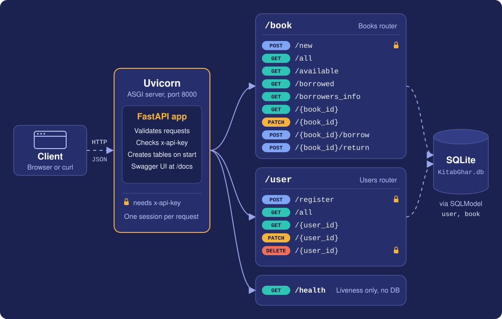

<p align="center">
  
</p>

<p align="center">
  
  
  
  
</p>

<p align="center">
  
  
  
  
  
  
  
</p>

---

##  About

**KitabGhar** (Hindi for *"house of books"*) is a REST API for a small book-lending service. It tries to mimic the **book rental system in the real world**: a library keeps a catalogue of books, registered members borrow them for a fixed period, and the books come back to the shelf when they are returned.

Every book is always in exactly one state, and the API enforces it:

-  **Available**: on the shelf and ready to be borrowed.
-  **Borrowed**: held by one registered user, with a start date and an end date.
-  **Removed**: taken out of circulation, with a removal date.

A book cannot be borrowed twice, a borrowed book cannot be removed before it is returned, and a user who still holds books cannot be deleted. Built with FastAPI and SQLModel, with automatic validation and OpenAPI docs.

---

##  How to Run

**1. Install `uv`**

```bash
pip install uv
```

**2. Clone the repository**

```bash
git clone https://github.com/Zain-Ahma12/KitabGhar.git
cd KitabGhar
```

**3. Create `.env` file** using **`.env.example`**
```bash
cp .env.example .env
```

> `X-API-KEY` is the secret that clients must send in the `x-api-key` header for the protected endpoints (see [API Endpoints](#api-endpoints)).

**4. Start the server.** `uv` creates the virtual environment and installs every dependency for you:

```bash
uv run main.py
```

The API is now running at **http://127.0.0.1:8000**. Tables are created automatically on startup.

| What | Where |
| --- | --- |
| Interactive docs | http://127.0.0.1:8000/docs |
| Health check | http://127.0.0.1:8000/health |

---

##  Folder Structure

```text
KitabGhar/
├── .venv/                  # Virtual environment created by uv
├── custom_docs_ui/         # Custom Swagger UI
│   ├── __pycache__/
│   ├── __init__.py
│   └── docs_ui.py          # setup_custom_docs(): dark mode, animation, typography
├── assets/                 # contains svg graphics for the animation in Readme
├── models/                 # SQLModel tables, request/response schemas, business rules
│   ├── __pycache__/
│   ├── __init__.py
│   ├── books.py            # Book table, book states, borrow/return/remove helpers
│   └── users.py            # User table and conversion helpers
├── routes/                 # FastAPI routers
│   ├── __pycache__/
│   ├── __init__.py
│   ├── book_routes.py      # /book endpoints
│   └── users_routes.py     # /user endpoints
├── .env.example            # copy of .env file for github
├── .gitignore
├── .python-version         # Python version used by uv
├── auth.py                 # x-api-key verification dependency
├── database.py             # Engine, table creation and session provider
├── KitabGhar.db            # SQLite database file
├── main.py                 # App entry point, lifespan, /health
├── pyproject.toml          # Project metadata and dependencies
├── README.md
├── uv.lock                 # Locked dependency versions
├── CONTRIBUTING.md         # Read this before contributing to this project
└── LICENSE.md              # MIT License
```

---

<a id="api-endpoints"></a>

##  API Endpoints

<p align="center">
  
</p>

Every request travels from the client to **Uvicorn**, which hands it to the **FastAPI** app. FastAPI validates it, routes it to the right endpoint, and the endpoint reads or writes the **SQLite** database through SQLModel.

###  Books `/book`

| Method | Endpoint | Description | Auth |
| :---: | --- | --- | :---: |
| `POST` | `/book/new` | Add a new book (starts as available) |  |
| `GET` | `/book/all` | List all books. Filters: `book_name`, `author`, `publish_year` (name and author are partial matches) | |
| `GET` | `/book/available` | List books that can be borrowed right now | |
| `GET` | `/book/borrowed` | List borrowed books with borrower and dates | |
| `GET` | `/book/borrowers_info` | Borrowed books grouped by borrower | |
| `GET` | `/book/{book_id}` | Get one book | |
| `PATCH` | `/book/{book_id}` | Update name, author, year or condition | |
| `POST` | `/book/{book_id}/borrow` | Borrow a book for an existing user | |
| `POST` | `/book/{book_id}/return` | Return a borrowed book | |

The list endpoints are paginated with `page` (default `1`) and `page_size` (default `10`, max `100`).

###  Users `/user`

| Method | Endpoint | Description | Auth |
| :---: | --- | --- | :---: |
| `POST` | `/user/register` | Register a new user (email must be unique) |  |
| `GET` | `/user/all` | List all users | |
| `GET` | `/user/{user_id}` | Get one user | |
| `PATCH` | `/user/{user_id}` | Update a user | |
| `DELETE` | `/user/{user_id}` | Delete a user (blocked while they hold books) |  |

###  Health

| Method | Endpoint | Description |
| :---: | --- | --- |
| `GET` | `/health` | Liveness check with uptime. Never touches the database |

###  Authentication

Endpoints marked with  require the `x-api-key` header to match the `X-API-KEY` value in your `.env` file. A wrong or missing key is rejected with `401 Unauthorized`.

```bash
curl -X POST http://127.0.0.1:8000/book/new \
  -H "Content-Type: application/json" \
  -H "x-api-key: replace-with-a-long-random-string" \
  -d '{"book_name": "The Guide", "author": "R. K. Narayan", "published_year": 1958}'
```

---

##  Custom Swagger UI

FastAPI's default `/docs` page is functional, but I wanted something that felt better to work in. So I built my own Swagger UI in the [`custom_docs_ui`](custom_docs_ui/) package. The default docs route is switched off in `main.py` and replaced with `setup_custom_docs(app, docs_path="/docs")`.

What it adds on top of the stock UI:

- **Dark mode** for comfortable reading at any hour.
- **Animations** that make the page feel smoother and more alive.
- **Updated typography** for a cleaner, more readable interface.

It is still the same OpenAPI-powered "Try it out" experience, just nicer to use. Start the server and open `/docs` to see it.

### Demo Video

[▶ Watch the Swagger UI Demo](https://zain-ahma12.github.io/Rangmanch-Review-api/)<!-- Add a screenshot:  -->

---

##  Contributing & License

Contributions are welcome, whether it is a bug report, a new feature or a small docs fix. Please read [CONTRIBUTING.md](CONTRIBUTING.md) for how to set up the project and open a pull request.

This project is licensed under the terms of the [LICENSE](LICENSE) file.

Thank you